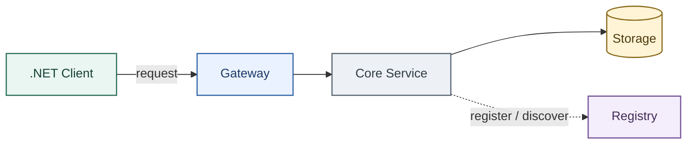
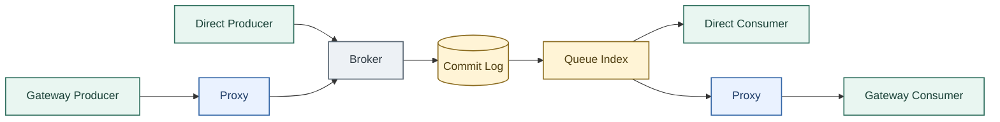
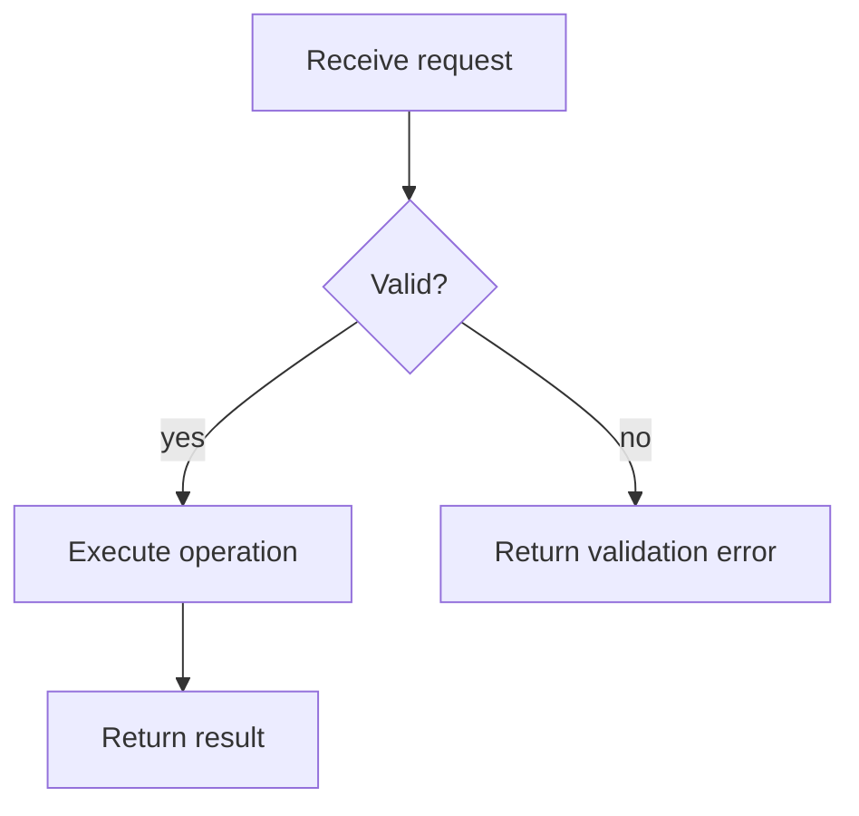

# Layout Patterns

Use these patterns as starting points. Replace placeholder roles and labels with facts from the user's material.

## System Architecture

Use `LR`, distinguish control-plane traffic with dashed edges, and assign colors by role.

## Data Flow With Two Access Paths

Keep shared storage in the center. Put alternate ingress and egress paths above and below it rather than creating one tall chain.

## Short Operational Flow

Use `TB` only when the flow is short and vertical reading is useful.

## Repairing Bad Aspect Ratios

For an image that is too tall:

1. Switch `TB` to `LR`.
2. Collapse descriptive text into the surrounding article.
3. Split optional branches into a second diagram.
4. Use parallel ingress/egress branches around a shared center.
5. Reduce rank spacing only after fixing the graph structure.

For an image that is too wide:

1. Group two or three closely related steps vertically inside a subgraph.
2. Add deliberate ` ` breaks to labels.
3. Split overview and detailed paths into separate diagrams.
4. Do not shrink the font to compensate for an overloaded graph.

## Repairing Ambiguous Connections

When a rendered edge appears to start from the wrong node, stop at a group border, or pass through a title, fix the graph structure before adjusting spacing:

1. Replace edges to subgraphs with edges to explicit nodes inside those subgraphs.
2. Give success, failure, timeout, and no-response paths separate nodes when they have different outcomes.
3. Make a successful path reach an explicit terminal state before drawing the retry path.
4. Use a note or waiting state for an event that did not occur, such as a missing ACK; do not depict absence as a write.
5. Route each cross-section edge to a specific side of its destination node so the arrowhead remains visible.
6. Move edges around section titles and labels. Do not solve an overlap by hiding a line behind a white label background.
7. Inspect the rendered image at full size and at normal article width. Mermaid source that looks logical is not sufficient if the rendered pixels imply a different relationship.

Mermaid may attach cross-subgraph edges to container boundaries even when the source is valid. After two focused layout revisions, switch to an explicit SVG rather than continuing to add invisible nodes or fragile ordering constraints. Keep the Mermaid source as the logical model and the SVG as the stable layout source.

## Sizing Nodes Around Content

Different shapes have different safe content areas. A label that fits inside the outer bounding box may still collide with a curve, angled edge, icon, divider, or decorative cap:

1. Identify the shape's safe content area before placing text. Exclude curved caps, angled corners, icons, headers, and other internal geometry.
2. Calculate the node dimensions from the rendered text block, line height, and explicit padding inside that safe area.
3. Position text relative to the inner geometry, not only the node's outer coordinates.
4. Keep balanced space above, below, and beside multi-line labels. Increase the node dimensions before reducing the font size.
5. Recheck the rendered PNG at normal article width. Any border or internal shape that appears to touch, underline, or crowd a label is a failed layout.

For example, a cylinder must reserve both curved caps, while a diamond needs extra horizontal space because its usable width narrows toward the top and bottom. The verification rule is the same for every shape: labels must remain entirely inside a clear, comfortably padded content area.
